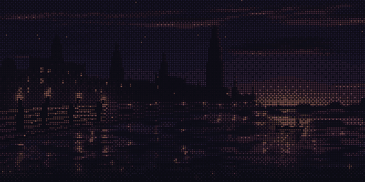
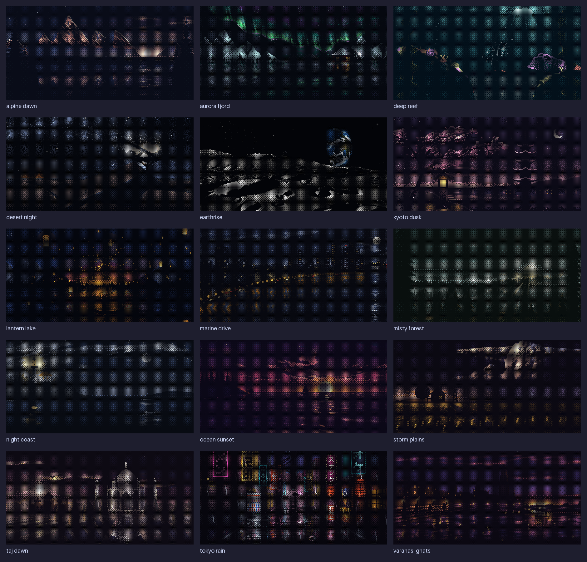

# Quickshell ASCII Wallpapers

Animated ASCII landscapes for [Quickshell](https://quickshell.org). Copy one directory into your shell, add a component, and let the scenes run.



The 15 scene algorithms and artwork come from **[ascii.rest by bas3line](https://github.com/bas3line/ascii)**. This project provides the Quickshell integration, background worker, GPU renderer, playback controls, and static fallbacks.

- All scenes cycle at their original 1× speed, with a five-minute interval by default.
- One Node worker serves every display, keeping scene generation off the QML thread.
- Double-buffered textures keep a complete frame on screen during updates.
- Pick a scene, build a playlist, pause, change speed, or match your shell's colors.
- Use it as a wallpaper or embed a scene inside any Qt Quick item.
- No npm dependencies, runtime downloads, or build step. Shader, glyph atlas, and stills are included.

## Try it

Requires **Quickshell 0.3.2+, Qt 6.8+, Node.js 22+**, and a Wayland compositor supporting layer-shell for desktop wallpapers. Tested on Niri with an ARM64 Linux desktop. Animated rendering needs Qt Quick's GPU backend; software rendering shows a still.

```sh
git clone https://github.com/saketatreya/quickshell-ascii-wallpapers.git
cd quickshell-ascii-wallpapers
qs -p preview.qml  # scene in a regular window
qs -p .           # wallpaper on all displays
```

Use one wallpaper provider per output. If another shell paints over the background layer, integrate this module into that shell or disable its wallpaper surface. Stop the standalone instance with `qs -p . kill`.

## Drop it into your shell

Copy the complete `AsciiWallpaper/` directory alongside your shell's `shell.qml`. Keep its assets, runtime, scenes, and licenses together. Quickshell requires relative imports to stay inside the shell's config directory.

```qml
import Quickshell
import "AsciiWallpaper" as Ascii

ShellRoot {
    Ascii.Wallpaper {}
}
```

For control over playback and appearance:

```qml
import QtQuick
import Quickshell
import "AsciiWallpaper" as Ascii

ShellRoot {
    Ascii.Wallpaper {
        id: wallpaper
        tintColor: "#1e1e2e"
        tintAmount: 0.16          // 0 uses the original scene colors
        fillMode: Image.PreserveAspectFit

        controller: Ascii.Controller {
            scene: "night-coast"
            speed: 1
            fps: 15
            cycleSeconds: 300
            playlist: ["night-coast", "aurora-fjord", "tokyo-rain"]
            // An empty playlist cycles all scenes.
        }
    }
    Ascii.Ipc { controller: wallpaper.controller }
}
```

Bind `controller.paused` to your shell's lock/display-off state to stop animation work. Bind `Wallpaper.visible` separately if you want to hide its surfaces. The module does not change compositor settings or start a lock screen.

For a widget, use `Ascii.SceneView { controller: scenes }` with an existing `Ascii.Controller`. Multiple views can share one controller. See [preview.qml](preview.qml), the [component API](docs/API.md), and the [DMS adapter](docs/DMS.md).

## Controls

The standalone example enables IPC. Run these from the repository directory; for an installed config, replace `-p .` with `-c your-shell`.

```sh
qs -p . ipc call asciiWallpaper status
qs -p . ipc call asciiWallpaper scenes
qs -p . ipc call asciiWallpaper next
qs -p . ipc call asciiWallpaper previous
qs -p . ipc call asciiWallpaper select tokyo-rain
qs -p . ipc call asciiWallpaper pin          # stop automatic cycling
qs -p . ipc call asciiWallpaper cycle 300    # seconds per scene; enable cycling
qs -p . ipc call asciiWallpaper speed 1
qs -p . ipc call asciiWallpaper pause
qs -p . ipc call asciiWallpaper resume
```

IPC changes are session-only. Edit your QML for persistent defaults, or connect the controller to your shell's settings service. `select` changes the current scene; `pin` keeps it selected.

## Scenes



`alpine-dawn` · `aurora-fjord` · `deep-reef` · `desert-night` · `earthrise` · `kyoto-dusk` · `lantern-lake` · `marine-drive` · `misty-forest` · `night-coast` · `ocean-sunset` · `storm-plains` · `taj-dawn` · `tokyo-rain` · `varanasi-ghats`

## Development

```sh
npm test                        # no npm install required
qs -p verify-controller.qml      # real Quickshell lifecycle checks
mkdir -p test-output/gpu
ASCII_RENDER_OUTPUT="$PWD/test-output/gpu" qs -p verify.qml
python3 tests/check-render.py test-output/gpu
```

The renderer check briefly opens a window and captures only its scene item. The image check requires Pillow. [Development notes](docs/DEVELOPMENT.md) cover software fallback checks, asset regeneration, the worker protocol, and importing upstream scenes.

## Credits and license

Quickshell integration: [Saket Atreya](https://github.com/saketatreya), [MIT](LICENSE).

Scene artwork and algorithms: [bas3line/ascii](https://github.com/bas3line/ascii), [MIT](AsciiWallpaper/scenes/LICENSE), vendored at the commit recorded in [provenance.json](AsciiWallpaper/scenes/provenance.json). The algorithms are unchanged apart from stripping TypeScript types. The four rendered glyphs use Noto Sans Mono; no font installation is required at runtime.
